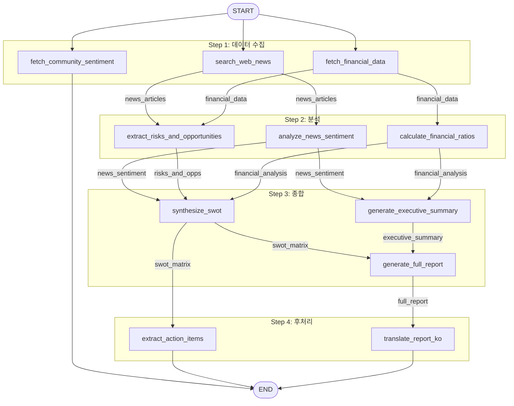

# DAG (flow-gen)

[English](README.md) | **한국어**

LLM Planner가 리서치 목표에 맞는 실행 DAG를 직접 짜는 LangGraph 오케스트레이터입니다. "애플 주식 분석 리포트 작성해줘" 같은 목표를 주면 Planner가 16개 노드 카탈로그에서 필요한 노드를 고르고 의존성과 병렬 그룹을 정하며, Executor가 그래프를 컴파일해 실행합니다.

```
목표 ──▶ Planner (LLM) ──▶ Plan JSON ──▶ Executor ──▶ LangGraph ──▶ 최종 state
         노드·엣지·        Pydantic       그래프       단계별         (리포트, SWOT,
         병렬 그룹 선택     검증           구성         병렬 실행       실행 과제 등)
```

> Planner는 실제 LLM을 호출하고, 노드 구현은 샘플 데이터를 반환합니다. 이 프로젝트의 초점은 동적 계획과 그래프 실행이며, 각 노드는 실제 데이터 소스를 연결할 자리입니다.

## 핵심 설계

- **고정된 노드 카탈로그**: [`nodes.py`](src/dag_langgraph/nodes.py)에 16개 노드가 이름, 읽고 쓰는 state 키 설명, 구현과 함께 정의돼 있습니다.
- **Planner 역할 제한**: Planner(Claude)는 카탈로그 설명만 보고 노드·엣지·병렬 그룹을 정합니다. 노드 구현이나 params는 건드리지 않습니다.
- **검증된 Plan**: Plan은 Pydantic 모델([`planner.Plan`](src/dag_langgraph/planner.py))입니다. 그래프 빌더가 사이클을 탐지하고 Kahn 알고리즘으로 위상 정렬합니다.
- **공유 state**: 모든 노드는 `fn(state) -> state_update` 형태이고, LangGraph state reducer로 병합되어 병렬 분기도 안전하게 씁니다.
- **API 키 없이도 실행**: `ANTHROPIC_API_KEY`가 없으면 내장 stub plan으로 실행합니다.

## 예시 DAG

목표 `"애플 주식 분석 및 최근 뉴스 리포트 작성해줘"`에 대해 Planner가 만드는 11개 노드, 4단계 파이프라인입니다.



## 빠른 시작

Python 3.11 이상과 [uv](https://docs.astral.sh/uv/)가 필요합니다.

```bash
uv sync --extra dev
cp .env.example .env        # ANTHROPIC_API_KEY (선택, 없으면 stub plan)

uv run flow-gen "애플 주식 분석 및 최근 뉴스 리포트 작성해줘"
uv run flow-gen "최신 AI 기술 논문 및 트렌드 조사해줘"
uv run flow-gen --list-nodes              # 노드 카탈로그 확인
uv run flow-gen -v "종합 리서치 보고서 생성해줘"   # 단계별 state 변화 출력
```

## Graph API 직접 사용

```python
from dag_langgraph import Graph, START, END, NODES

g = Graph()
g.add_node("search_web_news", NODES["search_web_news"].fn)
g.add_node("analyze_news_sentiment", NODES["analyze_news_sentiment"].fn)
g.set_entry_point("search_web_news")
g.add_edge("search_web_news", "analyze_news_sentiment")
g.set_finish_point("analyze_news_sentiment")

state = g.compile().invoke(initial_state={"ticker": "AAPL"})
```

## 새 노드 추가

[`src/dag_langgraph/nodes.py`](src/dag_langgraph/nodes.py)의 `_REGISTRY`에 `Node(name, description, fn)`을 추가합니다. 설명에 **읽는 state 키**와 **쓰는 state 키**를 적어 주세요. Planner는 이 설명만 보고 연결 여부를 판단합니다.

## 프로젝트 구조

```
src/dag_langgraph/
├── nodes.py      16개 노드 카탈로그 (수집 → 분석 → 종합 → 후처리)
├── planner.py    LLM → Plan (의존성, 병렬 그룹, stub fallback)
├── graph.py      state reducer 기반 그래프 빌더, 사이클 탐지, 위상 정렬
├── executor.py   Plan → 그래프 변환과 실행 파사드
└── cli.py        `flow-gen` CLI
tests/            pytest
```

## 테스트

```bash
uv run pytest
uv run pytest --cov=src --cov-report=term-missing
```
