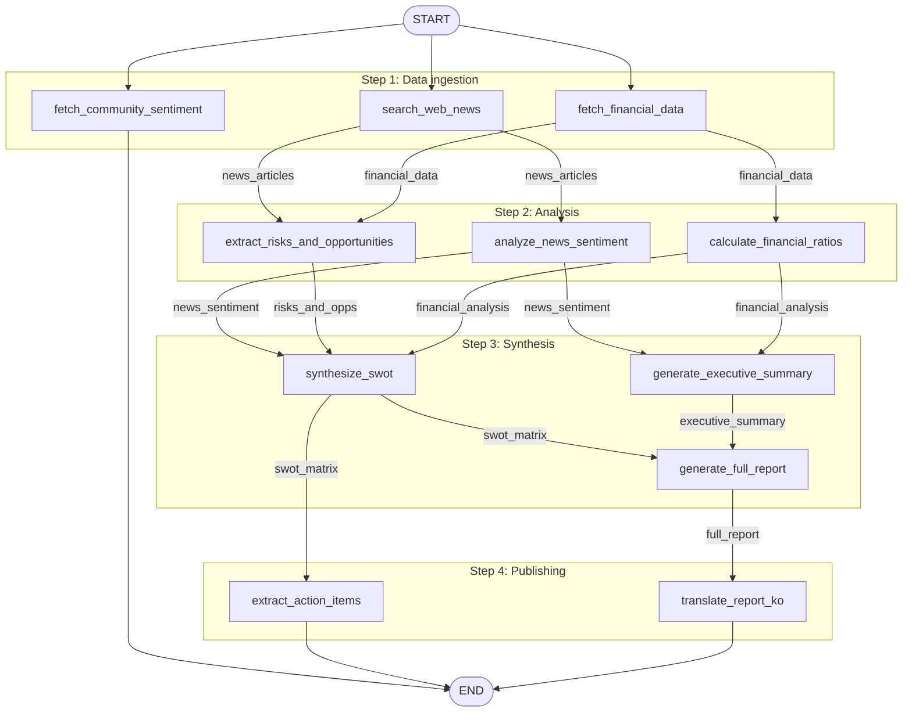

# DAG (flow-gen)

**English** | [한국어](README.ko.md)

A LangGraph orchestrator where an LLM planner builds the execution DAG for a research goal. Give it a goal such as "Analyze Apple stock and write a report", and the planner picks nodes from a 16-node catalog, wires their dependencies and parallel groups, and the executor compiles and runs the graph.

```
goal ──▶ Planner (LLM) ──▶ Plan JSON ──▶ Executor ──▶ LangGraph ──▶ final state
         picks nodes,       validated     builds       runs steps     (report, SWOT,
         edges, parallel    by Pydantic   the graph    in parallel     action items…)
```

> The planner is real; node implementations return sample data. The project focuses on dynamic planning and graph execution, and each node is a place to plug in a real data source.

## Key Ideas

- **Fixed node catalog**: 16 nodes in [`nodes.py`](src/dag_langgraph/nodes.py), each with a name, a description of the state keys it reads and writes, and an implementation.
- **Limited planner role**: The planner (Claude) sees only the catalog descriptions. It chooses nodes, edges, and parallel groups, but never changes node code or parameters.
- **Validated plan**: The plan is a Pydantic model ([`planner.Plan`](src/dag_langgraph/planner.py)). The graph builder detects cycles and orders nodes with Kahn's algorithm.
- **Shared state**: Every node is `fn(state) -> state_update`, merged through LangGraph state reducers so parallel branches can write safely.
- **Runs without an API key**: Without `ANTHROPIC_API_KEY`, a built-in stub plan runs instead.

## Example DAG

For the goal `"애플 주식 분석 및 최근 뉴스 리포트 작성해줘"` ("Analyze Apple stock and write a recent news report"), the planner builds this 11-node, 4-step pipeline:



## Quick Start

Requires Python 3.11+ and [uv](https://docs.astral.sh/uv/).

```bash
uv sync --extra dev
cp .env.example .env        # ANTHROPIC_API_KEY (optional; stub plan without it)

uv run flow-gen "애플 주식 분석 및 최근 뉴스 리포트 작성해줘"
uv run flow-gen "최신 AI 기술 논문 및 트렌드 조사해줘"
uv run flow-gen --list-nodes              # show the node catalog
uv run flow-gen -v "종합 리서치 보고서 생성해줘"   # verbose: state changes per step
```

## Using the Graph API Directly

```python
from dag_langgraph import Graph, START, END, NODES

g = Graph()
g.add_node("search_web_news", NODES["search_web_news"].fn)
g.add_node("analyze_news_sentiment", NODES["analyze_news_sentiment"].fn)
g.set_entry_point("search_web_news")
g.add_edge("search_web_news", "analyze_news_sentiment")
g.set_finish_point("analyze_news_sentiment")

state = g.compile().invoke(initial_state={"ticker": "AAPL"})
```

## Adding a Node

Add `Node(name, description, fn)` to `_REGISTRY` in [`src/dag_langgraph/nodes.py`](src/dag_langgraph/nodes.py). State which keys the node **reads** and **writes** in the description: the planner decides how to connect nodes from the description alone.

## Project Structure

```
src/dag_langgraph/
├── nodes.py      16-node catalog (ingest → analyze → synthesize → publish)
├── planner.py    LLM → Plan (dependencies, parallel groups, stub fallback)
├── graph.py      Graph builder with state reducers, cycle check, topological sort
├── executor.py   Plan → graph and run facade
└── cli.py        `flow-gen` CLI
tests/            pytest
```

## Tests

```bash
uv run pytest
uv run pytest --cov=src --cov-report=term-missing
```
